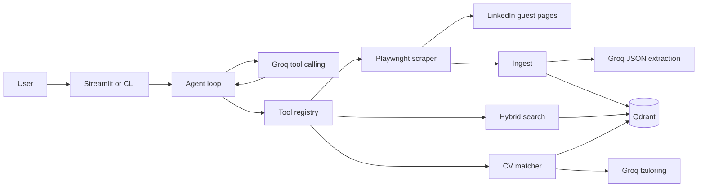

# JobSeek

JobSeek scrapes public LinkedIn job listings, stores them for hybrid retrieval in Qdrant, and uses a tool-calling agent to search those jobs, score a CV against them, and draft tailored resume bullets.

## Overview

Searching a job board and then comparing each posting to a CV by hand does not scale, and a single vector search is a poor fit for both exact skills (`FastAPI`, `Kubernetes`) and broader role language. JobSeek splits that work into a scraper, a retrieval index, a separate multi-factor matcher, and a small agent that decides which of those to call.

The agent does not invent listings. Search results, match scores, and scrape runs all come back from tools that hit Qdrant or LinkedIn.

## Key features

- **Public LinkedIn scrape.** Async Playwright, with stealth, opens the guest search page and up to nine job cards, then opens each detail page for the description and criteria.
- **Structured extraction.** Groq returns a `JobProfile` and hard filters (`location`, `remote`, `seniority`, salary bounds, visa, clearance, age) validated against Pydantic schemas.
- **Hybrid retrieval.** Each job is stored as a 384-dimensional dense vector (`BAAI/bge-small-en-v1.5`, cosine) and a BM25 sparse vector (`Qdrant/bm25`). Queries prefetch both lists and fuse them with reciprocal rank fusion (RRF).
- **CV matching is not vector search.** The matcher scrolls every stored job and scores structured profiles: skills, responsibilities, years, and seniority, with weights redistributed when a field is missing.
- **Tool-calling agent.** A Groq model chooses among seven tools for up to eight steps. Streamlit accepts a PDF, DOCX, or TXT CV. A terminal loop is available for search and scraping without an upload.

## Architecture



`project01(storagevc)` is the data plane: scrape, extract, embed, search, match, and a small FastAPI wrapper. `project02` is the agent and UI. It puts `project01(storagevc)` on `sys.path` and calls those functions directly. The two folders are not separate deployable services in the default path.

## Technology stack

| Area | Choice |
|---|---|
| Scraper | Python `asyncio`, Playwright, `playwright-stealth` |
| Extraction and agent model | Groq chat completions, Pydantic JSON schemas, native tool calling |
| Dense embeddings | `sentence-transformers`, `BAAI/bge-small-en-v1.5` (384 dims, cosine) |
| Sparse embeddings | FastEmbed `Qdrant/bm25` |
| Vector store | Qdrant, named vectors `dense` and `sparse`, RRF fusion |
| CV scoring | In-process weights; skill alias match; cosine similarity on responsibility sentences |
| UI | Streamlit. Optional FastAPI on `/health`, `/matches`, `/scrape-and-embed`, `/match-cv` |
| Packaging | Docker Compose for Qdrant plus the Streamlit app. A second Compose file runs the API |

## How it works

1. **Scrape.** `fetch_LinkedIn_jobs.py` builds a LinkedIn guest search URL from keywords and a location, reads up to nine cards, and waits two seconds between detail pages. Each record keeps title, company, location, date, URL, and the detail-page text.
2. **Extract.** For every job, Groq fills a `JobProfile` (skills, technologies, responsibilities, seniority, years, role aliases) and a `JobFilters` object. Both calls use JSON schema response format.
3. **Embed and store.** The dense text is title, company, location, role aliases, technologies, years, and seniority. The sparse text adds the raw description, so exact tokens still match. Qdrant stores both vectors plus `profile`, `raw_job`, and `job_filters`. The collection is created on first connect if it does not exist.
4. **Search.** The query is split into hard filters and free text. Filters become a Qdrant `must` filter. The free text is embedded twice: dense, with the BGE query prefix `Represent this sentence for searching relevant passages:`, and sparse BM25. Each side prefetches 20 hits. RRF merges them and the caller’s `limit` is what comes back.
5. **Match a CV.** Groq turns the CV into a `CandidateShape`. The matcher scrolls the collection in batches of 60 and scores each payload. Missing components drop out of the weight total instead of being treated as zero-weight leftovers. Top rows can be sent back to Groq for match reasons and CV bullets that are instructed to stay inside the uploaded CV.
6. **Agent.** The system prompt tells the model to check `get_job_stats` when the index might be empty, prefer `search_jobs` for broad questions, use `match_all_jobs` only after a CV is uploaded, and call `tailor_cv` only after a match pass. Tool results are truncated to 1,500 characters in memory. The loop stops after eight steps.

### Match weights

Starting weights, before empty fields are removed:

| Component | Weight | Score |
|---|---|---|
| Skills | 35 | Alias-normalized exact overlap. Required skills count for 70% and preferred skills for 30% when both lists exist. |
| Responsibilities | 30 | Cosine similarity between responsibility sentences. Pairs under 0.65 are zeroed, then the row is the mean. |
| Experience | 20 | `1.0` when the candidate meets the asked years, otherwise candidate years divided by asked years. |
| Seniority | 15 | Ordered levels from `entry level` through `director`. `1.0` when the candidate is at or above the job, otherwise the ratio of the two levels. |

The returned `final_score` is a weighted sum of those 0–1 component scores, so it also falls between 0 and 1.

## Project structure

```text
.
├── docker-compose.yaml          # Qdrant + Streamlit
├── Dockerfile                   # Streamlit image
├── .env.example
├── project01(storagevc)/        # scrape, index, match, FastAPI
│   ├── fetch_LinkedIn_jobs.py
│   ├── fetch_specific_LinkiedIn_job.py
│   ├── embed_jobs.py            # ingest, Search, match_cv_tailor
│   ├── qDrantStore.py           # collection, filters, RRF query
│   ├── groq_client.py
│   ├── model_provider.py
│   ├── api.py
│   ├── matching_engine/
│   ├── models/
│   ├── docker-compose.yaml      # optional API + Qdrant
│   └── Dockerfile
└── project02/                   # agent and UI
    ├── app.py                   # Streamlit
    ├── cli.py
    ├── settings.py              # loads .env and puts project01 on sys.path
    ├── agent/                   # loop, prompt, memory
    └── tools/                   # schemas and implementations
```

Folder names are part of the import and Compose paths, so they are unchanged.

## Prerequisites

- Python 3.10 or newer (`str | None` is used in the profile models)
- Docker, if you want Compose to run Qdrant or the full UI image
- A Groq API key
- Network access on first run so Hugging Face / FastEmbed can download `BAAI/bge-small-en-v1.5` and `Qdrant/bm25`
- Chromium for Playwright, installed with the command below. The Docker image installs it during the build

No spaCy language-model download is required. The scraper does not log into LinkedIn.

## Installation and setup

From the repository root:

```powershell
python -m venv .venv
.venv\Scripts\Activate.ps1
pip install -r "project01(storagevc)/requirements.txt" -r project02/requirements.txt
playwright install chromium
copy .env.example .env
```

On macOS or Linux, activate with `source .venv/bin/activate` and copy the env file with `cp .env.example .env`.

Put your Groq key in `.env`. An existing `project01(storagevc)/.env` still overrides the root file if both are present.

Start Qdrant:

```powershell
docker compose up qdrant_database -d
```

Qdrant’s HTTP API is on port 6333. The first Streamlit or API request creates the `linkedIn_jobs` collection.

## Environment configuration

| Variable | Required | Purpose |
|---|---|---|
| `GROQ_API_KEY` | Yes | Groq key for extraction, the agent, and tailoring. |
| `GENERATION_MODEL` | Yes | Groq model id. It must support tool calling and JSON schema responses. The example is `openai/gpt-oss-20b`. |
| `HOST` | Yes for local runs | Qdrant host. Use `127.0.0.1` outside Docker. Compose sets `qdrant_database` or `qDrant-DB` for containers. |
| `PORT` | Yes | Qdrant HTTP port. `6333`. |
| `COLLECTION_NAME` | Yes | Qdrant collection. `linkedIn_jobs`. |

`SYSTEM_PROMPT_RANKING` and `SYSTEM_PROMPT_RECOMMENDING` are not read by the agent or the matcher. The live prompts are in `project02/agent/prompt.py` and `project01(storagevc)/groq_client.py`.

## Running the project

Streamlit, from `project02`, with the virtualenv active and Qdrant already up:

```powershell
cd project02
streamlit run app.py
```

Open `http://127.0.0.1:8501`. Upload a CV before asking which jobs fit. Example prompts:

- `How many jobs are stored?`
- `Search for junior Python jobs in the United States. Do not scrape.`
- `Scrape junior Python developer jobs in the United States.`
- `Which stored jobs match my CV?`
- `Rewrite bullets for the top matches.`

Terminal agent, same directory. This loop cannot upload a CV, so matching tools will ask for one:

```powershell
python cli.py
```

Optional HTTP API, from `project01(storagevc)`, still with Qdrant on `127.0.0.1:6333`:

```powershell
cd "project01(storagevc)"
uvicorn api:app --host 127.0.0.1 --port 8000
```

| Method | Path | Body |
|---|---|---|
| `GET` | `/health` | none |
| `POST` | `/matches` | JSON `{"query": "junior python developer"}` |
| `POST` | `/scrape-and-embed` | none. Runs in the background with keywords `junior software engineer` and location `United States`. |
| `POST` | `/match-cv` | multipart file field `file` plus optional form field `limit`. The file is decoded as UTF-8 text, not PDF. |

Full UI in Docker, from the repository root. This builds the Playwright image, starts Qdrant, and serves Streamlit on port 8501. Do not run it at the same time as `project01(storagevc)/docker-compose.yaml`; both publish port 6333.

```powershell
docker compose up --build
```

The API Compose file is the alternative, from `project01(storagevc)`:

```powershell
docker compose up --build
```

That file publishes the API on port 8000 and Qdrant on 6333.

## Verification and troubleshooting

This repository was checked against the current source, Compose files, and env loading. The full scrape, model download, and Groq calls were not re-run as part of the documentation pass, so a fresh machine still has to download models and pass LinkedIn’s current markup.

Confirm Qdrant is up:

```powershell
curl http://127.0.0.1:6333/collections
```

Confirm the API, if you started it:

```powershell
curl http://127.0.0.1:8000/health
```

A healthy API returns `{"status":"ok"}`. An empty collection is valid. Ask the agent for job stats, or call `POST /scrape-and-embed`, before expecting search hits.

Common failures:

- **`Connection refused` to Qdrant.** The database container is not running, or `HOST` inside a container is still `127.0.0.1`. Local `.env` should say `127.0.0.1`. Compose overrides that for containers.
- **Groq 401 or missing model.** `GROQ_API_KEY` is empty, or `GENERATION_MODEL` is not a model that this account can call with tools and JSON schema.
- **Search returns nothing for a specific query.** Hard filters are a `must` clause. A seniority or location filter that no payload satisfies removes every point before RRF can rank them. Try a broader query, or scrape again.
- **Scrape returns no jobs.** LinkedIn’s guest HTML changes, and the scraper depends on `ul.jobs-search__results-list` and the public detail-page selectors. There is no login or retry queue. A run also stops at nine cards.
- **`match-cv` fails on a PDF.** That endpoint only UTF-8-decodes the upload. Use Streamlit for PDF and DOCX.
- **First search or match is slow.** The dense and sparse models download and load on first use. Matching then encodes responsibility sentences for every stored job.
- **Ingest hits Groq rate limits.** Each job makes two generation calls. The free tier’s tokens-per-minute cap will surface as API errors during a scrape.

Generated local files (`linkedIn_data.json`, `cv_profile.json`, `match_tailor.json`, `final ai rec.txt`, uploaded CV text) are gitignored. Do not commit `.env`.
